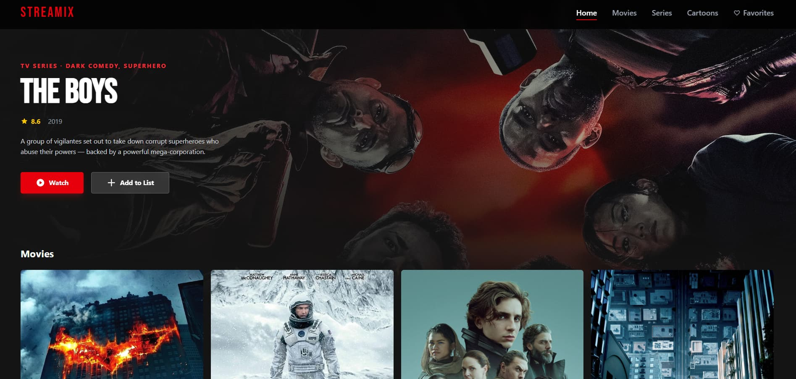

# Streamix

A Netflix-style streaming catalog — portfolio project built with React + TS + Vite, with an Express + MongoDB API for accounts and personal lists.



## Tech stack

| Tool | Version |
|------|---------|
| React | 19 |
| React Router | 7 |
| TypeScript | 6 |
| Tailwind CSS | 4 |
| Framer Motion | 12 |
| TanStack Query | 5 |
| Vite | 8 |
| Express (API) | 5 |
| MongoDB / Mongoose | 9 |
| Zod (API validation) | 4 |

## Getting started

Needs Node 24, a [TMDB API key](https://www.themoviedb.org/settings/api) and a MongoDB database (a free Atlas cluster works).

```bash
npm install
npm --prefix server install
```

- `.env` in the project root: `VITE_TMDB_KEY=<your TMDB key>`
- `server/.env`: copy `server/.env.example` and fill in `MONGODB_URI` and `JWT_SECRET`

Run the API and the app in two terminals:

```bash
npm run server   # API on http://localhost:3001
npm run dev      # app on http://localhost:5173, proxies /api to the API
```

---

## Features

### Core
- React + Vite project setup with Tailwind CSS v4
- React Router v7 — 10 routes: `/`, `/movies`, `/series`, `/cartoons`, `/favorites`, `/watch-later`, `/search`, `/browse`, `/login`, `/register`
- Full TypeScript migration — discriminated union types (`Movie | Show`), strict mode
- Dark-only theme (`#141414` background, red-600 accent)
- Bebas Neue bold font for logo and headings
- **TMDB API integration** — live data across multiple endpoints; genre ID maps; normalizer layer

### Accounts & lists
- **Sign up / sign in** — email + password, confirm-password check, per-field validation errors from the API
- **Sessions** — JWT in an httpOnly, SameSite=Lax cookie (7 days); the frontend only ever talks to same-origin `/api`
- **Favorites & Watch Later** — stored per account in MongoDB; optimistic toggles with rollback via TanStack Query
- **Protected pages** — `/favorites` and `/watch-later` redirect to sign-in and back
- **localStorage import** — lists saved before accounts existed move into the account on first sign-in
- **API hardening** — bcrypt hashes, rate-limited credential endpoints, helmet, Zod-validated input, unique indexes

### Components
- **Navbar** — fixed top bar with logo, active-link red underline, responsive mobile drawer, account menu
- **Hamburger menu** — animated 3-line → X toggle, slide-in drawer, backdrop, auto-closes on navigation
- **HeroBanner** — full-viewport auto-rotating hero (5s interval), parallax scroll, dual gradient overlays, Watch / Add to Favorites CTAs
- **MovieCard** — poster with hover scale + red glow, type badge, TMDB logo watermark, heart and watch-later toggles
- **MovieModal** — spring entrance animation, trailer embed fetched live from TMDB, full metadata (director/creator, cast, runtime/seasons, country)
- **SkeletonCard** — pulse skeleton matching card dimensions, used as lazy-load fallback
- **ScrollRow** — horizontal slider with native `scrollBy` arrows, hidden scrollbar, staggered card entrance, "See All" link per row

### Pages & features
- **Home** — HeroBanner + horizontal rows: Upcoming, Now Playing, Top Rated, then genre rows (Drama, Action, Sci-Fi, etc.) built from live TMDB data
- **Movies / Series / Cartoons** — full-page grid from TMDB popular endpoints
- **Favorites / Watch Later** — per-account lists, heart and clock toggles on cards and the hero banner, loading, error and empty states
- **Search** — expanding input in navbar (spring animation), 700ms debounce, TMDB `/search/multi` endpoint, skeleton loading, relevance-sorted MovieCard grid
- **Browse** — "See All" destination; handles predefined lists (`?list=top-rated / now-playing / upcoming`) and genre filters (`?genre=Action`)
- **Trailer modal** — YouTube embed fetched from TMDB on modal open; prefers official trailer, falls back to any trailer or teaser
- **Live metadata** — cast, director/creator, runtime/seasons, country fetched from TMDB detail endpoint on modal open
- **Page transitions** — Framer Motion `AnimatePresence` fade between routes + scroll-to-top on navigation
- **Staggered animations** — grid and slider cards animate in with spring on page load
- **Lazy loading** — all pages code-split with `React.lazy` + `Suspense`

---

## Project structure

```
src/
├── types/
│   └── content.ts              # Movie | Show discriminated union
├── api/
│   ├── tmdb.ts                 # Fetch helpers, genre maps, normalizers, search, video, detail endpoints
│   ├── client.ts               # Same-origin /api fetch wrapper + ApiError
│   ├── auth.ts                 # register / login / logout / me
│   └── lists.ts                # Favorites & Watch Later endpoints, item identity (media type + id)
├── hooks/
│   ├── useTMDB.ts              # Generic fetch hook → { items, loading, error }
│   ├── useAuth.tsx             # Session state, restored from /api/auth/me
│   ├── useSignOut.ts
│   ├── useUserList.ts          # TanStack Query list + optimistic toggle
│   ├── useFavorites.tsx        # useUserList('favorites')
│   ├── useWatchLater.tsx       # useUserList('watch-later')
│   └── useLegacyListsImport.ts # One-time localStorage → account import
├── components/
│   ├── Navbar.tsx              # Top nav + mobile drawer + expanding search with debounce
│   ├── UserMenu.tsx            # Sign-in link / account dropdown
│   ├── AuthForm.tsx            # Shared sign-in / sign-up form
│   ├── RequireAuth.tsx         # Route guard for account pages
│   ├── ListContent.tsx         # Loading / error / empty / grid for list pages
│   ├── MovieCard.tsx           # Poster card with hover effects, favorites + watch later
│   ├── MovieModal.tsx          # Detail modal with live trailer + metadata
│   ├── HeroBanner.tsx          # Auto-rotating full-viewport hero
│   ├── ScrollRow.tsx           # Horizontal genre slider with arrow buttons + See All link
│   ├── PageWrapper.tsx         # Framer Motion page transition wrapper
│   └── SkeletonCard.tsx        # Pulse skeleton for loading states
├── pages/
│   ├── Home.tsx                # HeroBanner + Netflix-style rows
│   ├── Movies.tsx
│   ├── Series.tsx
│   ├── Cartoons.tsx
│   ├── Favorites.tsx
│   ├── WatchLater.tsx
│   ├── Login.tsx
│   ├── Register.tsx
│   ├── Search.tsx              # Live TMDB search results
│   └── Browse.tsx              # Full grid for list or genre filter
├── context/
│   ├── AuthContext.tsx
│   ├── FavoritesContext.tsx
│   └── WatchLaterContext.tsx
├── data/
│   └── featuredMovies.ts       # Hero banner rotation list (static, curated)
└── utils/
    ├── motionVariants.ts       # Shared Framer Motion variants
    ├── groupByGenre.ts         # Groups ContentItem[] by primary genre
    └── safeRedirect.ts         # Keeps ?redirect= inside the app

server/                         # Express 5 + TypeScript API
├── src/
│   ├── index.ts                # Connect to MongoDB, then listen
│   ├── app.ts                  # Middleware + routes (importable for tests)
│   ├── controllers/            # auth, lists, health routers
│   ├── models/                 # User, ListItem (Mongoose)
│   ├── middleware/             # requireAuth, errorHandler, requestLogger
│   └── utils/                  # config (env), session (JWT cookie), logger
├── requests/                   # VS Code REST Client files for manual testing
└── .env.example
```

---

## Deployment

```
Browser → Vercel (static build + /api/* rewrite) → Render (Express API) → MongoDB Atlas
```

The browser only ever sees the Vercel domain, so the session cookie is first-party and no CORS is needed. The API URL lives in `vercel.json`.

| Where | Setting |
|-------|---------|
| Vercel | Framework: Vite, root: repo root, env `VITE_TMDB_KEY` |
| Render | Root directory `server`, build `npm ci --include=dev && npm run build`, start `npm start`, health check `/api/health` |
| Render env | `MONGODB_URI`, `JWT_SECRET`, `NODE_ENV=production`, `TRUST_PROXY` |

`--include=dev` matters: with `NODE_ENV=production` npm skips devDependencies, and the TypeScript build needs them. The free Render instance sleeps after ~15 minutes idle, so the first API request after a break takes up to a minute.
